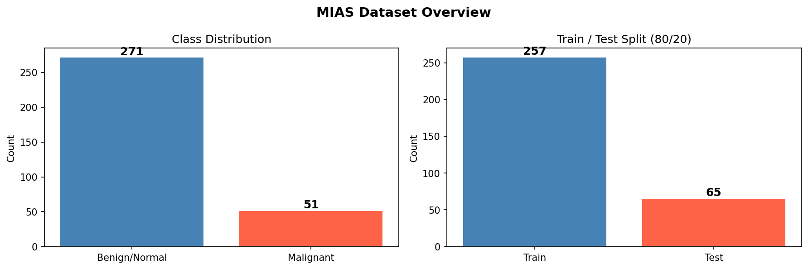
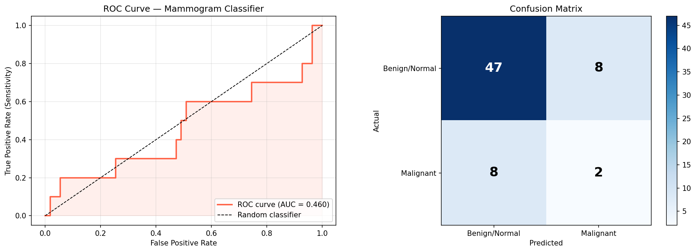
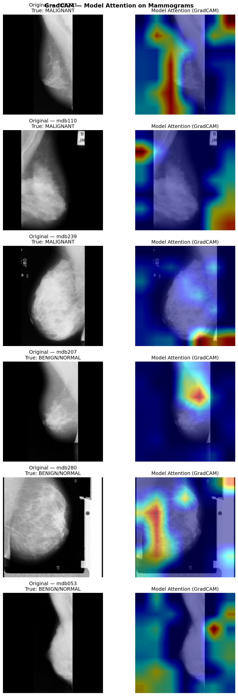

---
title: Mammogram Classifier
emoji: 🩺
colorFrom: blue
colorTo: pink
sdk: docker
pinned: false
---

# Mammogram Classifier: EfficientNet-B0 + Grad-CAM

An end-to-end research prototype: a mammogram image classifier with Grad-CAM explanations, packaged in Docker and deployed as a public Streamlit app on Hugging Face Spaces.

**Live demo:** ADD-HUGGING-FACE-SPACE-URL

> **Research and educational use only.** This is not a medical device. The current model does not perform better than chance on the held-out test set (see Results) and must not be used for any clinical decision.

## What it does

1. You upload a mammogram (JPG, PNG or PGM).
2. EfficientNet-B0 returns the probability of *Malignant* vs *Benign/Normal*. The decision threshold is lowered to 0.40 to favour sensitivity.
3. Grad-CAM overlays a heatmap showing which regions drove the prediction.
4. Images are processed in memory only. Nothing is stored or logged.

## Data

| | Count |
|---|---|
| Dataset | MIAS (Mammographic Image Analysis Society), public |
| Total images | 322 |
| Benign/Normal | 271 |
| Malignant | 51 (16%) |
| Train / test split | 257 / 65 (80/20) |



## Results (held-out test set, n = 65)

| Metric | Value |
|---|---|
| ROC AUC | **0.46** |
| Sensitivity (malignant recall) | 2 / 10 = **20%** |
| Specificity | 47 / 55 = 85% |
| Accuracy | 49 / 65 = 75% |
| Baseline accuracy of "always predict benign" | 55 / 65 = 85% |



**Interpretation:** the model is not yet useful. Its accuracy looks acceptable at 75%, but that is *below* the 85% you get by predicting "benign" for every image, and the AUC is at chance level. This is a textbook example of why accuracy misleads on imbalanced data. Sensitivity and AUC are the metrics that matter for screening.

### Likely causes

- **Very small training set:** only about 40 malignant training images.
- **Whole-image input at 224×224:** MIAS images are 1024×1024, and lesions can be a few pixels after downsizing.
- **No class reweighting, and no cross-validation** on a 65-image test set, so a single split gives unstable estimates.

### Next steps

- [ ] Train on ROI patches around annotated lesions (MIAS provides coordinates)
- [ ] Add class weights or focal loss, plus stronger augmentation
- [ ] Use stratified 5-fold cross-validation and report AUC with confidence intervals
- [ ] Test a larger dataset (CBIS-DDSM)
- [ ] Choose the threshold from the cross-validated ROC at a target sensitivity

## Grad-CAM



Grad-CAM shows model attention, not lesion location. With the current model performance, the heatmaps should not be read as clinically meaningful.

## Tech stack

Python · PyTorch · torchvision EfficientNet-B0 · pytorch-grad-cam · Streamlit · Docker · Hugging Face Spaces

## Run locally

```bash
docker build -t mammogram-classifier .
docker run -p 7860:7860 mammogram-classifier
# open http://localhost:7860
```

## Project structure

```
app.py               Streamlit app: inference + Grad-CAM
model.pth            Trained EfficientNet-B0 weights
Dockerfile           Container for Hugging Face Spaces
requirements.txt
dataset_overview.png roc_curve.png gradcam_all.png
```

## Author

Ammara · Marketing Data Scientist · [Portfolio](ADD-PORTFOLIO-URL) · [LinkedIn](ADD-LINKEDIN-URL)

Licensed under MIT (see LICENSE).
